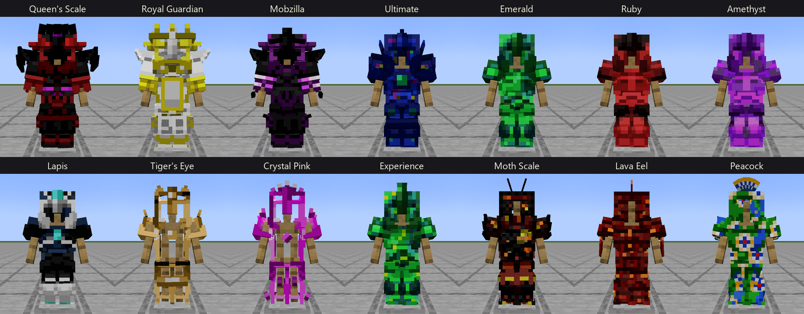
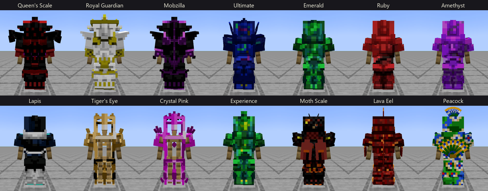
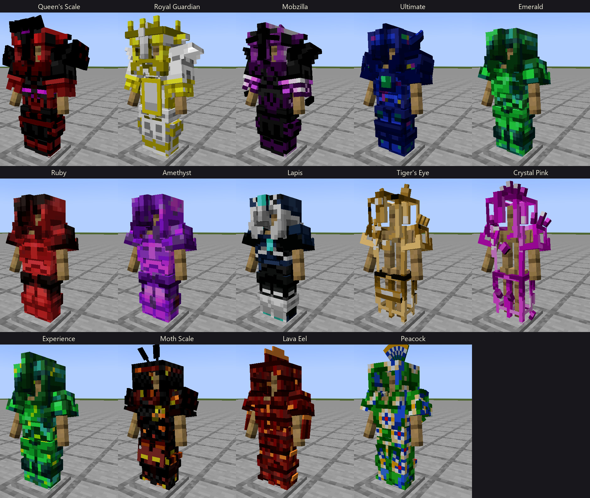
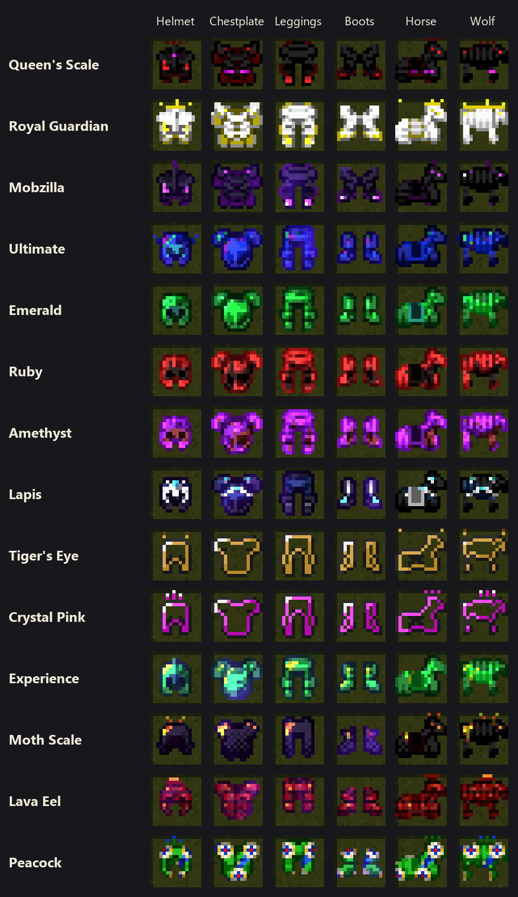
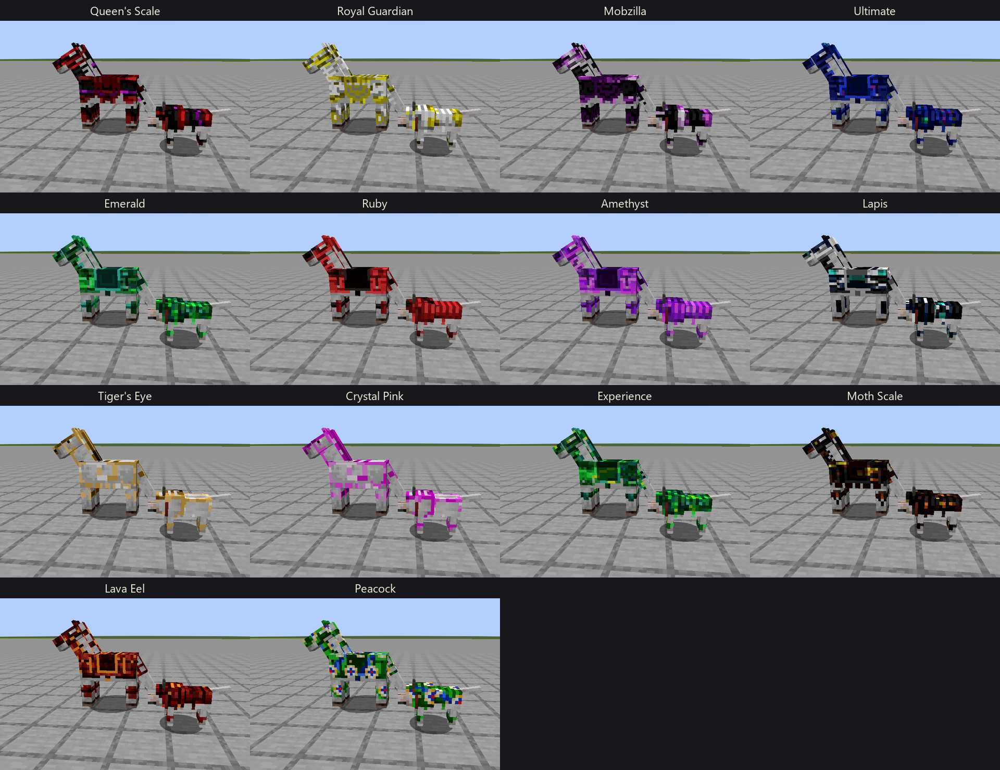

# OreSpawn for NeoForge 1.21.1 — 2.0.0-beta.16

Version `1.21.1-2.0.0-beta.16` (`gradle.properties`; `README.md` line 6), on beta.15: the new Modern armour, the Gamma Metroid's shell whole, the Ghost and the Ghost Skelly counted as ambient creatures again, and MultiHitboxLib's GeckoLib renderer mixins on the client only.

## Part one — for the player

New Modern armour for all 14 sets, the Gamma Metroid's shell is whole again, Ghosts and Ghost Skeletons keep to the ambient mob cap again, and dedicated servers start without two MultiHitboxLib errors.

**Changed**
- New Modern armour for all 14 sets: 3D pieces with each set's own details, from the Queen's tiara and the King's crown to Mothscale's wings and the Peacock's feather fan; new textures and icons; the horse, wolf and dog armour to match. Choose Modern or Classic in the OreSpawn Visuals screen (O by default); Classic is unchanged.

**Fixed**
- The Gamma Metroid's shell no longer has a hole on its right side. Two faces of each dome piece were left half unpainted; they now show the shell's pattern.
- Dedicated servers start without the two "invalid dist" errors from MultiHitboxLib.
- On Halloween the Mining dimension (and every biome with the day's Ghosts) no longer fills with Ghosts and Ghost Skeletons, on Peaceful included: they count toward the ambient mob cap again, as in the original.

**Good to know**
- Ghosts and Ghost Skeletons already in a world stay; new ones stop coming once the ambient cap is full, so a crowded area thins out as they despawn.
- A command selector with a distance or a volume (`@e[type=orespawn:alien,distance=..10]`) also returns each multi-hitbox creature's hitbox parts, as NeoForge does for every multipart entity, the Ender Dragon included: an Alien answers 14, a dragon 9. Without a distance or volume a selector returns the creature alone.

**Install:** put `orespawn-1.21.1-2.0.0-beta.16.jar` in `mods/` (NeoForge 21.1, Minecraft 1.21.1, GeckoLib 4.7 or newer) and take the beta.15 jar out. For the spears, add Mounts of Mayhem 1.9.8.

### beta.16 in pictures

**The new Modern armour.** All 14 sets, front and back.

**Up close.** Each set from three-quarters: the Queen's tiara and mantle, the King's crown and cape, Ultimate's wings and core gem, the Peacock's fan.

**The new icons.** Every set's four pieces, its horse armour and its wolf armour, as the inventory draws them.

**Horse and wolf armour.** Each set's armour on a horse and a wolf.

## Part two — for the modder

- The Modern style's 491 files are new: `armour_geo/<set>_<piece>.json` (56), `textures/models/armor/modern/` (atlases and dog textures with `_n`/`_s`), `textures/item/modern/` icons and `models/item/modern/` models, the horse and wolf armour's textures, icons and item models, and `textures/gui/visuals/modern.png`. The spears are unchanged. `tools/armour_asset_pins.json` pins the new files; the asset audit passes.
- `textures/entity/gammametroid.png`: 392 fully clear pixels on the dome's side and underside faces (shell1 at 95,0 to 114,31; shell2 at 24,30 to 40,54) are painted from each piece's opposite face, mirrored as the box wraps. Painted pixels and every other part of the sheet are unchanged; the classic model and the geo rig share this layout.
- `multihitboxlib.mixins.json`: `geckolib.MixinGeoEntityRenderer`, `MixinGeoReplacedEntityRenderer` and `MixinGeoRenderer` move from `mixins` to `client`.
- `orespawn:ghost` and `orespawn:ghost_skelly` are `MobCategory.AMBIENT` (were `MONSTER`). They are drawn from ambient lists only, and 1.21 counts a mob toward its type's category alone, so as monsters they never filled the ambient cap. Mods that read the category (mob-cap tools, spawn tweakers) see them as ambient now. A selector with a distance or volume (`@e[type=orespawn:alien,distance=..N]`) still returns each multi-hitbox mob's parts as well, as NeoForge does for every multipart entity, the Ender Dragon included; a selector without one returns the mob alone.

### Tests and tooling

`spawncount_a`: the spawner's own count (`NaturalSpawner.createState`) puts Ghosts and Ghost Skellies in the ambient cap and none in the monster cap. `spawncount_b`: every ambient creature that only ambient lists carry (any day of the tables, and the mod's own biomes) counts as ambient. `wgen101a` reads the colours the game draws with, `getModifiedSpecialEffects()`: NeoForge points every read of a biome's effects at the modified ones except `getSpecialEffects()` itself, which keeps the biome file's own, so on a fresh config the test failed though Chaos was red in game.

The armour probe (`ArmourModelProbe`) checks each part's own base box: the cube that sits on vanilla's armour box on the player, wherever it stands in the file, drawn there on every wearer, grown and as a baby. The Modern pieces whose shells, plates and pauldrons stand off vanilla's box by design are named in `NO_BASE_BOX` (45 pieces: every chestplate, legging and boot, and the Queen's, the Royal Guardian's and Mobzilla's helmets); a named part with such a cube fails, as does an unnamed part without one.

Measured on a dedicated server with a stand-in player on the Mining dimension's surface (96 blocks round, a count each minute, 10 minutes on Normal then 10 on Peaceful, the date gates set to 31 October): with beta.15, up to 39 Ghosts and 19 Ghost Skellies near the player on Peaceful and the spawner counting 42 to 85 monsters there; with beta.16, 4 to 9 Ghosts and no monsters.

### The harness

Checks on the release tree: drift 0; `RESULT: 0 error(s), 0 advisory(ies), 4 acknowledged; draw order: 104 shipped geo: 103 seam + 1 outside-seam`, `ARMOUR MODELS PASS: 56 pieces`, `G1 PARITY PASS` 2, 13 and 101 models, checked-in proof verified, `BUILD SUCCESSFUL in 8m 17s`; the gametest suite: `All 1454 required tests passed`, `BUILD SUCCESSFUL in 4m 7s` — 1452 tests at beta.15 plus `spawncount_a` and `spawncount_b`. Re-pinned: the T2 proof's Gamma Metroid entry (its repainted shell) and the benchmark (its harness classes moved with the armour probe).

### Third-party notices and credits

Unchanged from beta.15.
